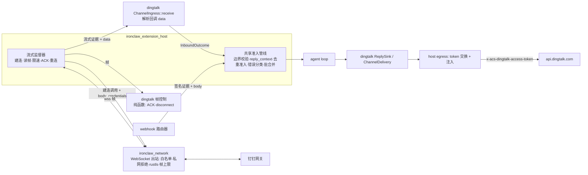

本计划为 IronClaw 新增钉钉企业内部应用机器人渠道(Stream 长连接模式),覆盖单聊、群聊 @机器人和主动推送,先交付通用的"host 持有的流式入站"能力,再交付钉钉包;本版已按 2026-11-18 的计划审查结果修订。

# 钉钉渠道接入计划(Stream 模式,修订版)

日期:2026-11-18

> 本文件取代同名文件的早期版本。审查发现与本版的处理方式见文末"审查记录"。HTTP 回调方案保留在"备选方案"。

## 问题陈述

让用户能在钉钉里通过单聊和群聊(@机器人)与助手对话,助手的回复发回钉钉,并支持通过 `builtin.outbound_deliver` 主动推送到指定人或群。接入方式为钉钉 **Stream 模式**:IronClaw 主动建立出站 WebSocket 长连接,不需要公网入口。

## 已确认的需求与决策

- 机器人类型:企业内部应用机器人。自定义群机器人只能单向推送,满足不了需求。
- 入站:Stream 模式。
- 范围:单聊、群聊(@机器人)、主动推送。
- 回复:纯文本/Markdown 一次性发送(`[channel.reply] transport = "message"`)。
- 配对:管理员在 `[admin_configuration]` 里配置应用凭证,用户在 WebUI 生成一次性验证码,发给机器人完成配对(`web_generated_code`)。
- 决策 1(WebSocket 传输):扩展 `ironclaw_network`,新增受策略保护的出站 WebSocket,不做 Telegram MTProto 式的豁免。
- 决策 2(信任边界):接受新增一种密封证据("连接已认证的流式入站"),仍由 `ironclaw_extension_host` 唯一的 `ChannelIngressVerifier` 实现铸造。在通用层代码之前设置 ADR 评审关卡。
- 决策 3(交付顺序):里程碑一交付通用流式入站并用 `acme` 夹具验证;里程碑 1b 交付 token 交换;里程碑二交付钉钉包。
- 环境:目前没有钉钉应用。Stream 模式不需要公网地址,但需要创建应用。
- **部署模型(2026-11-20 确认,选 A)**:钉钉渠道的真实需求是让**其他运营者**用**他们自己组织的钉钉**对接消息网关。每个运营者自己部署 IronClaw,对接自己组织的钉钉企业内部应用,凭证由该部署的管理员在 `[admin_configuration]` 里填写。一个部署只对接**一个**钉钉组织。
  - 这与现有设计一致,通用层和钉钉包的结构不变。Stream 模式不要求公网入口,正适合自托管的运营者。
  - **范围外**:同一个部署服务多个钉钉组织(每个组织各自的应用凭证)、以及上架钉钉应用市场的第三方企业应用。这两种都会触发 overview §1080 表中"一个部署需要多个由管理员选择的实例"所要求的新 ADR,本计划不做。
  - **设计假设要写进文档和代码**:`senderStaffId` 只在一个钉钉企业内部唯一,所以身份键沿用 `senderStaffId` 的前提是"一个部署对应一个组织"。为了在这个前提被误用时尽早失败,Task 12 和 Task 17 校验回调里的 `chatbotCorpId`/`senderCorpId` 与首次见到的组织一致(具体规则由 Task 1 核实后确定),不一致的消息不进入准入并记录脱敏的审计事件。
  - **新增交付物**:面向外部运营者的上手文档(见 Task 19),并在 Task 20 里按文档从零走一遍来验证。

## 待决事项

- **ADR 批准人**:已指定为本计划的提出人(用户本人),2026-11-18 确认,并已于同日批准 `docs/internal/2026-11-18-dingtalk-stream-adr.md`(记录在该文件"批准"一节)。`crates/contracts/ironclaw_host_api/AGENTS.md` 写明密封证据"do not widen",新增证据变体需要所有者明确批准,Task 1 的评审关卡以该批准人的书面通过为准。批准记录写在 ADR 文件末尾的"批准"一节(批准人、日期、结论、附带条件)。
- **多副本**:钉钉在同一应用的多条连接间如何分发消息尚未核实,作为 Task 1 的门槛(见 Task 1)。

## 背景(调研结论)

### 钉钉 Stream 协议(对照官方 Python SDK 源码核实)

- 建连:`POST https://api.dingtalk.com/v1.0/gateway/connections/open`,请求体含 `clientId`、`clientSecret`、`subscriptions`(机器人回调主题 `/v1.0/im/bot/messages/get`)、`ua`、`localIp`。响应给出 `endpoint` 和 `ticket`,随后连接 `wss://<endpoint>?ticket=<URL 编码的 ticket>`。
- 帧:JSON,`type` 为 `SYSTEM`/`EVENT`/`CALLBACK`。`headers` 含 `messageId`、`topic`;`data` 是 JSON 字符串。
- ACK:每个帧都要回 `{code, headers{messageId, contentType}, message, data}`,否则钉钉会重投。
- 保活与重连:客户端每 60 秒发 WebSocket ping。`SYSTEM` 帧的 `disconnect` 主题要关闭并重新建连。SDK 的重连退避为 1 到 60 秒加抖动。SDK 并发处理最多 100 个帧,会乱序。
- 机器人消息字段:`msgId`、`conversationId`、`conversationType`("1" 单聊,"2" 群聊)、`senderStaffId`、`senderCorpId`、`chatbotCorpId`、`isInAtList`、`sessionWebhook`、`robotCode`、`chatbotUserId`。
- 发送:OpenAPI 需要请求头 `x-acs-dingtalk-access-token`,由 `POST /v1.0/oauth2/accessToken`(`appKey`/`appSecret`)换取,响应带 `accessToken` 和 `expireIn`。SDK 在发送接口里把 `robotCode` 取为 `clientId`。
- **仍需 Task 1 用官方文档核对**:多连接分发、未 ACK 的重投时机与次数、ACK 时延上限、限流、WebSocket 网关主机集合、字段约束、`robotCode` 与 `clientId` 的关系。

### 仓库现状(已读代码验证)

- 渠道是扩展的一个能力面。新增渠道是 `crates/extensions/packages/dingtalk/`(manifest 加 crate)加二进制里一条绑定。
- 二进制在 `crates/app/ironclaw_cli/src/runtime/native_extensions.rs` 用 `NativeExtensionFactory`(`runtime.service` 字符串)和 `ChannelExtensionBinding` 接线,并有绑定存在性测试。
- **入站契约**:
  - `ChannelIngressDescriptor` 的 `verification` 必填。
  - `ChannelDescriptor::validate` 要求非 `authenticated_session` 入站必须有 `route_suffix`(否则 `WebhookIngressWithoutRouteSuffix`),`connection` 要求存在 `ingress`。
  - 引用 `route_suffix` 或 `.verification` 的 Rust 文件有 30 个,包括 `crates/app/ironclaw_cli/src/commands/serve.rs` 的路由挂载、`ironclaw_extension_host` 的 `channel_config.rs`、`ingress/{mod,router,verifier}.rs`。
- **路由器的准入管线**(`crates/extensions/ironclaw_extension_host/src/ingress/router.rs`):验证之后依次做 `message.validate()` 边界校验、把 `reply_context` 写入宿主存储(送达协调器靠它路由回复)、`sink.admit` 的 durable 去重 `(installation, event_id)`、错误分类(瞬时返回 503 让厂商重投,确定性失败 ACK 后丢弃),以及 `BatchFragment` 的延迟合并(`InboundBatchProcessor`)。
- `ChannelIngress::receive(VerifiedInbound)` 返回 `InboundOutcome::{Messages, BatchFragment, Respond, Ignore}`。`VerifiedInbound` 带 `body`、`headers`、`config`、`can_reply_in_threads`。
- `channel_host.rs` 的 `build_generic_graph` 已经为每个渠道产出 `ChannelIngressRegistration`(sink 加 drain),可以复用。
- **密封证据**:`VerifiedInbound` 证据只能由 `ironclaw_extension_host` 唯一的 `ChannelIngressVerifier` 实现铸造(`reborn_sealed_evidence_mint_ratchet`)。`AuthRequirement` 现有 `RequestSignature`、`SharedSecretHeader`、cookie、`BearerToken` 变体。`channel_host.rs` 的 `evidence_mint_for_verification` 由校验配方推出证据,流式入站没有配方。
- **网络**:`ironclaw_network` 是唯一的出站策略所有者和唯一的 `reqwest`/TLS 所在地,只有 HTTP,`reqwest` 使用 `rustls-tls-native-roots`。`NetworkScheme` 只有 `Http`/`Https`,被 68 个文件引用(ADR 实测,其中只有 2 处穷尽的 `match` 需要处理新增的 `Wss`)。`ChannelDescriptor::validate` 拒绝 egress 主机里的通配符。
- **依赖**:`Cargo.lock` 已有 `tungstenite`/`tokio-tungstenite` 0.23 和 0.29;`tokio-tungstenite` 只作为 composition 和 webui 的 dev 依赖,特性是 `connect`,没有 TLS。`deny.toml` 的许可证允许列表包含 MIT 和 Apache-2.0。
- **建连调用**:现有 `ChannelVendorCallRecipe` 只有 method、path、body 和 `body_credentials`,没有响应映射。`body_credentials` 可以把密钥按 JSON 指针注入请求体。
- egress 路径约束禁止 `?`,所以带查询参数的 `sessionWebhook` 不能用作回复通道。回复和推送统一走 OpenAPI 加令牌。
- `ironclaw_auth` 有刷新与保活机制,但没有 `client_credentials` 授权类型。
- `web_generated_code` 的 `deep_link_template` 可选,`inbound_code_prefixes` 可为空。
- **测试模板**:`tests/integration/extension_ingress.rs` 用 `acme` 夹具驱动真实生产挂载,覆盖 ING-1 到 ING-12(ING-8 是先持久化后 ACK、重复与重启重放,按 libSQL/PostgreSQL 矩阵);`tests/integration/extension_delivery.rs` 覆盖投递;E2E 有 `tests/e2e/fake_telegram_api.py`。`docs/internal/qa/telegram-coverage-map.md` 引用的 `reborn_integration_telegram_journey` 在 `tests/` 中不存在。
- 运营状态里"渠道级就绪探针尚未接入"(`Unsupported`)。

## 方案

- **共享准入管线**:把 webhook 路由器"验证之后"的流程抽成一个共享函数,webhook 路由器和流式监督器都调用它。这样 `reply_context`、边界校验、去重、错误分类和批合并只有一份实现。
- **适配器**:消息解析复用现有的 `ChannelIngress::receive`,帧的 `data` 作为 `VerifiedInbound.body`,一致性套件和附件补全不用重写。只新增一个很小的纯函数 trait 处理帧控制(哪些帧要回什么 ACK、`disconnect` 是否重连),不做 I/O,不接触密钥。
- **通用层改动**:
  1. `ironclaw_network`:受策略保护的 WebSocket 出站。
  2. `ironclaw_extension_contracts`:入站传输方式改为带标签的枚举(webhook / stream / authenticated_session),流式声明,帧控制 trait。
  3. `ironclaw_host_api`/`extension_contracts`:新增流式入站的密封证据变体。
  4. `ironclaw_extension_host`:共享准入管线,监督器,生命周期与状态。
  5. 里程碑 1b:token 交换。
- **`packages/dingtalk/`**:`payload.rs`(回调解析)、`stream.rs`(帧控制)、`render.rs`、`channel.rs`、`reply.rs`、`preference_targets.rs`。依赖集与 Slack 一致:`host_api`、`extension_contracts`、`attachments`。
- **会话模型**:`conversation_model = "continuous"`。单聊按用户,群聊按 `conversationId`。群里只处理 @机器人 的消息,其余为已认证的 no-op。
- **流式入站的语义**:
  - 帧先过大小上限和速率上限,再交给帧控制和 `receive`。
  - 共享管线返回结果后才 ACK:接受或重复则 ACK;瞬时失败不 ACK,让钉钉重投;确定性失败 ACK 后丢弃。
  - 同一会话内按到达顺序准入,不同会话之间可以并发。

## 任务拆分

### 里程碑一:通用的流式入站(用 `acme` 夹具验证,不涉及钉钉)

#### Task 1: 核对钉钉文档,准备环境,写 ADR(评审关卡)

- 目标:把来自 SDK 源码的钉钉细节落成有来源的事实,并在写通用层代码前取得对信任边界和网络边界变更的批准。
- 指导:
  - 核对官方文档并记录来源:
    - 多连接分发语义。
    - 未 ACK 的重投时机与次数,以及 ACK 时延上限。
    - `disconnect` 语义和每个应用的连接数上限。
    - **WebSocket 网关返回的主机集合**(是否固定、是否轮换)。
    - 限流(连接、消息、发送接口)和单条消息长度上限。
    - 回调字段的完整定义与约束,`robotCode` 与 `clientId` 的关系,`chatbotCorpId`/`senderCorpId` 的含义。
    - 两个发消息接口(`oToMessages/batchSend`、`groupMessages/send`)的请求和响应,以及是否有可用于回读的查询接口。
    - 重复请求 `accessToken` 是否返回同一令牌。
  - **多副本门槛**:如果钉钉不保证一条消息只投给一条连接,或者无法确定,则本计划只承诺单副本部署,并在 Task 9 的就绪诊断和用户文档里明确写出。
  - 在钉钉开放平台创建企业内部应用,开通机器人,选择 Stream 模式,拿到 `ClientID`/`ClientSecret`。
  - 把脱敏的真实帧样例存为测试夹具。
  - 在 `docs/internal/` 写 ADR,必须覆盖:
    1. **WebSocket 出站**:`wss` 的表达方式(扩展 `NetworkScheme`,需处理 68 个引用文件里的 `match`,其中 2 处是穷尽匹配;或在网络层使用独立类型)。主机白名单:逐个声明,还是放宽 egress 通配符(需要说明风险)。TLS 必须与 `reqwest` 使用同一个 `rustls` 和原生根证书,不引入第二套证书信任。
    2. **入站契约**:传输方式改为带标签枚举,对 30 个使用点的影响。流式声明的字段(建连调用、响应映射、订阅主题、地址模板、主机、保活、帧上限、速率上限)。帧控制 trait 的形状,以及消息解析复用 `ChannelIngress::receive`。
    3. **密封证据**:新增 `AuthRequirement` 变体及其全部触点(见 Task 4),说明为什么不新增实现者也不新增 grant。
    4. **共享准入管线**:从路由器抽取的边界和行为不变的保证。
    5. **监督器**:每连接速率上限、同会话顺序、背压、ACK 时延与重投窗口的关系、审计事件、生命周期、状态落点、多副本结论。
    6. **token 交换的位置**(供里程碑 1b 使用):A 为 auth 配方并持久化到 secret store,B 为 egress 凭证来源加内存缓存,C 为适配器自己换取(必须否决,令牌会进入适配器作用域)。
    7. **威胁模型**:网关返回的 `endpoint` 带来的 SSRF 风险;`clientSecret` 出现在建连请求体;`ticket` 按秘密处理;重连风暴;帧洪泛;帧内身份字段只有在连接已认证时才可信。
  - ADR 末尾增加"批准"一节,记录批准人(计划提出人)、日期、结论和附带条件。批准人评审通过后才开始 Task 2。
  - 批准人本人也是计划作者之一,因此 ADR 评审时要把"审查记录"表和上述七项内容逐条对照,并重点复核第 3 项(密封证据拓宽)和第 1 项(WebSocket 出站),这两项是仓库规则明确要求所有者批准的边界。
- 测试:无代码。
- Demo:ADR 通过评审;夹具提交;一个不进入仓库的小脚本能连上网关并收到一条真实回调。

#### Task 2: `ironclaw_network` 的 WebSocket 出站

- 目标:提供受策略保护的出站 WebSocket 客户端端口,其他 crate 不能自己开 socket。
- 指导:
  - 先读 `crates/substrates/ironclaw_network/src/{policy,resolver,url_target,egress,transport}.rs` 和 `docs/internal/reborn/contracts/network.md`,保持同样的 fail-closed 语义和错误模型。
  - 复用 `StaticNetworkPolicyEnforcer`、`NetworkResolver`(私有和保留地址拒绝)、`url_target`。按 ADR 实现 `wss` 的表达;如果扩展 `NetworkScheme`,逐个检查所有 `match`。
  - 引入 `tokio-tungstenite`(`default-features = false`,TLS 特性与 `reqwest` 的 `rustls` 和原生根证书一致)作为 `ironclaw_network` 的正常依赖。该 crate 保持为唯一持有它的生产 crate,并扩展单一出站边界扫描(`reborn_runtime_http_egress_has_single_network_boundary` 一类),让其他生产 crate 直接使用 WebSocket 客户端时失败。
  - 限制:帧大小、消息大小、连接超时、空闲和 pong 超时、消息速率。不跟随重定向。DNS 解析结果固定,连接时再次检查私网地址。
  - 提供回环测试缝隙:端口以 trait 形式由 composition 注入,集成 harness 可以替换为回环假网关(仅 `debug_assertions` 或 `test-support` 下编译,参照 `RewriteNetworkTransport`)。
  - `cargo deny check` 通过,并记录新增特性带来的传递依赖和许可证。
- 测试(先写):回环 WebSocket 服务端上的用例,覆盖允许和拒绝的主机、私网地址、重定向被拒、超大帧、超时、慢速攻击、服务端主动关闭、错误输出不含 URL 查询参数。
- Demo:回环测试通过 `ironclaw_network` 连上假网关并收发一帧;私网地址和未列白名单的主机被拒绝。

#### Task 3: 入站契约重构与流式声明

- 目标:manifest 能声明流式入站,契约里定义帧控制 trait,现有 webhook 渠道行为不变。
- 指导:
  - **先枚举**引用 `route_suffix` 和 `.verification` 的 30 个 Rust 文件,以及 WebUI 的渠道投影和前端类型,把清单写进 PR。
  - `ironclaw_extension_contracts`:
    - `ChannelIngressDescriptor` 的传输方式改为带标签枚举(webhook / stream / authenticated_session)。保持现有 manifest 的写法向前兼容:旧写法解析为 webhook,`kind = "authenticated_session"` 的规则不变。
    - 更新 `ChannelDescriptor::validate`:route_suffix 只对 webhook 必需;`connection` 对流式入站同样允许。
    - 流式声明:建连调用(复用 `ChannelVendorCallRecipe` 加 `body_credentials`,新增响应映射:`endpoint` 和 `ticket` 的 JSON 指针,`ticket` 标记为秘密)、订阅主题模板、WebSocket 地址模板、显式主机列表、保活间隔、帧上限、速率上限。
    - 新增帧控制 trait(例如 `ChannelStreamControl`):纯函数,输入帧,输出 ACK 和控制指令(`Continue`、`Reconnect`、`Deliver(data)`)。消息解析仍走 `ChannelIngress::receive`。
    - `ChannelSurfaces` 增加对应槽位;更新绑定一致性检查(声明流式入站必须同时绑定 ingress 和帧控制)。
    - 契约 crate 有大小上限门禁(`reborn_contracts_crates_carry_a_checked_size_ceiling`)。在 PR 里写明提高上限的理由和新增行数。
  - `ironclaw_extension_registry`:v3 解析、resolved 记录、digest,升级差异分类(新增 WebSocket 主机属于权限扩大)。
  - **acme 流式夹具**:在 `tests/fixtures/extensions/` 新增流式版本的 acme manifest 和适配器(帧控制加 `receive`),供里程碑一的所有测试使用。
  - 一致性套件(`test_support/conformance.rs`)增加流式部分。
  - 更新 `docs/internal/reborn/extension-runtime/overview.md` 和相关 crate 的 README/AGENTS。
- 测试(先写):
  - `channel.rs` 的解析和校验用例(三种传输互斥、旧 webhook 写法不变、缺字段、非法指针、非法主机、上限过大)。
  - `manifest_v3_contract.rs`、`product_adapter_manifest_ingestion.rs` 的扩展。
  - 现有 webhook 渠道(slack、telegram、acme)的测试全量通过,不做过滤。
  - 契约位置扫描(`reborn_extension_contract_location_scan.rs`)保持通过。
- Demo:acme 流式 manifest 能解析,digest 稳定;slack 和 telegram 的 manifest 解析结果与改动前相同。

#### Task 4: 流式入站的密封证据

- 目标:流式帧可以合法地变成已验证入站,同时保持只有 host 的 verifier 能铸造。
- 指导:
  - 触点(全部要改并测试):
    - `crates/contracts/ironclaw_host_api/src/product_adapter/auth.rs`:新增 `AuthRequirement` 变体(例如带连接所属安装的流式认证),补 `validate_metadata`。
    - `ironclaw_extension_contracts::verified_inbound`:新增铸造入口,仍消耗 `VerifiedInboundGrant`。
    - `crates/extensions/ironclaw_extension_host/src/extension_ingress.rs`:`VerifiedEvidenceMint` 新增流式变体,`ChannelIngressVerifier` 仍只在此实现。
    - `crates/extensions/ironclaw_extension_host/src/channel_host.rs`:`evidence_mint_for_verification` 处理流式传输。
    - `crates/app/ironclaw_architecture_tests/tests/reborn_sealed_evidence_mint_ratchet.rs` 和 `crates/contracts/ironclaw_host_api/tests/protocol_auth_evidence_seal.rs`。
  - 不新增 grant,不新增实现者,grant 保持非 `Clone`/`Default`/`Deserialize`。
  - 证据只在监督器完成"建连调用成功且 WebSocket 握手成功"之后铸造,安装标识来自连接所有权,不来自帧内容。
- 测试(先写):棘轮测试仍通过;新增负面用例证明包和产品代码无法铸造新证据;铸造入口和 `validate_metadata` 的单元测试。
- Demo:棘轮测试证明仍只有 host 的 verifier 实现 `ChannelIngressVerifier`。

#### Task 5: 从路由器抽取共享准入管线(纯重构)

- 目标:webhook 和流式入站共用一份"验证之后"的流程,行为不变。
- 指导:
  - 从 `ingress/router.rs` 抽出:`InboundOutcome` 的处理、`message.validate()`、`reply_context` 写入、`sink.admit`、错误分类(瞬时、确定性)、`BatchFragment` 的暂存与合并(`InboundBatchProcessor`)。
  - 输出与传输无关的结果(例如"已准入""重复""瞬时失败""确定性丢弃""立即响应"),webhook 路由器把它映射为 HTTP 状态码,监督器把它映射为 ACK 决策。
  - 这是移动加接口抽取,PR 里声明行为不变,不夹带行为修改。
- 测试:
  - `cargo test -p ironclaw_extension_host --no-fail-fast` 全量运行,输出不经 `head`/`tail` 过滤。
  - `tests/integration/extension_ingress.rs` 的 ING-1 到 ING-12 全部通过,包括 libSQL/PostgreSQL 矩阵。
  - 任何失败都视为被掩盖的行为,先报告,不修改断言。
- Demo:重构前后 webhook 入站的测试结果一致。

#### Task 6: 监督器:建连与读帧

- 目标:对一个活跃安装建立流式连接,读帧,交给帧控制和 `receive`,结果进入共享管线。
- 指导:
  - 在 `ironclaw_extension_host` 新增监督器模块,只依赖 Task 2 的 WebSocket 端口。
  - 执行建连调用(经 egress,`body_credentials` 注入 `clientId`/`clientSecret`),按响应映射取 `endpoint` 和 `ticket`,校验主机在声明列表内,再建立 WebSocket。`ticket` 和带查询参数的 URL 不进入日志、错误或状态。
  - 每帧依次:大小上限、每连接速率上限、帧控制 `decode`。需要投递的 `data` 以 `VerifiedInbound.body` 交给 `ChannelIngress::receive`,证据为 Task 4 的流式证据,结果交给 Task 5 的共享管线。
  - 复用 `build_generic_graph` 产出的 `ChannelIngressRegistration`。
  - 发出与 webhook 路径同等的审计事件(连接建立、断开、认证失败、帧被拒)。
- 测试(先写,用回环假网关):正常收消息;建连调用 401 时 fail-closed;返回未声明主机时拒绝;超大帧和超速率被拒;日志和错误里没有 `ticket` 和 `clientSecret`。
- Demo:acme 流式渠道在假网关上收到消息并进入共享管线。

#### Task 7: 监督器:ACK、顺序、背压与重连

- 目标:ACK 时机正确,同会话有序,慢准入不会无限堆积,断线自动恢复。
- 指导:
  - ACK 只在共享管线返回结果之后发出:已准入或重复则 ACK;瞬时失败不 ACK;确定性丢弃则 ACK。
  - 同一会话按到达顺序准入,不同会话可以并发;并发总数有上限。准入慢时停止读帧(背压)。
  - ACK 时延接近 Task 1 核实的重投窗口时,记录告警。
  - `disconnect` 帧、服务端关闭、ping/pong 超时都触发重连。退避为指数加抖动,上限由 ADR 决定,收到健康帧后重置。连续认证失败不无限重试,进入"需要管理员处理"状态。
- 测试(先写):断言 ACK 一定发生在准入提交之后;重复帧;未 ACK 的重投;同会话顺序;背压;`disconnect` 触发重连;暂停时间下的退避;认证失败停止重试。
- Demo:断线后自动重连;同一会话的消息按序进入 agent。

#### Task 8: 监督器生命周期与启动恢复

- 目标:连接随激活、停用、配置变更、删除和进程启动正确启停。
- 指导:
  - 激活时启动,停用和删除时停止并等待排空(`ChannelIngressDrain`),管理员凭证变化触发重启。
  - 启动时经现有 boot hydration 恢复已激活的安装。
  - 每个安装最多一条连接;全局连接总数有上限。
  - composition 只负责装配和后台任务生命周期,不放领域逻辑。
- 测试(先写):激活、停用、删除、凭证轮换、启动恢复;优雅关闭时排空且无残留任务;在 `channel_host/e2e_tests.rs` 中增加经 host 通路的流式用例。
- Demo:在 harness 里,激活后连接建立,轮换凭证后连接重建,停用后连接关闭。

#### Task 9: 连接状态与就绪诊断

- 目标:管理员能看到每个流式渠道的连接状态,内容已脱敏。
- 指导:
  - 状态(已连接、重连中、需要管理员处理、最近一次脱敏错误和时间)写进扩展生命周期投影,并进入 composition 的就绪诊断(替换当前"渠道级就绪探针尚未接入"的 `Unsupported`,或为流式渠道单独增加检查,按 ADR 决定)。
  - 如果 Task 1 的结论是只支持单副本,在就绪诊断里给出明确提示。
  - WebUI 只渲染投影,不推断状态。
- 测试(先写):投影内容不含秘密;各状态转换;就绪诊断的输出。
- Demo:WebUI 的扩展页显示 acme 流式渠道的连接状态。

#### Task 10: 里程碑一集成测试与门禁

- 目标:里程碑一在集成层可证明,能独立评审和合并。
- 指导:
  - 新增 `tests/integration/extension_stream_ingress.rs`,以 `tests/integration/extension_ingress.rs` 为模板,用 acme 流式夹具和注入的回环假网关,镜像 ING-1 到 ING-8:
    - 激活后建立连接(对应路由挂载)。
    - 建连认证失败被拒。
    - 先持久化后 ACK,重复帧和"新 sink 重启"重放只准入一次,按 libSQL/PostgreSQL 矩阵。
    - 消息经真实 `DefaultProductSurface` 进入 turn。
    - 停用后断开。
  - 在 seam 上断言(准入记录、ACK 帧、turn 提交),不能只看 `wait_for_status(Completed)`。
  - 为新增或改动的 crate 补 `BoundaryRule`,确认通用代码没有厂商名(`reborn_extension_specificity.rs`)。
  - 更新 `docs/internal/reborn/contracts/network.md`、extension-runtime overview 和相关 README/AGENTS。
  - 门禁(按顺序):
    - `cargo fmt`
    - `cargo clippy --all --benches --tests --examples --all-features -- -D warnings`
    - `cargo clippy --all --tests --examples -- -D warnings`(默认特性,若改动了 `#[cfg(feature)]`)
    - `cargo test`
    - `cargo test -p ironclaw_architecture_tests`
    - `cargo deny check`
    - `python3 scripts/ci/docs_publication_boundary.py`
    - `scripts/reborn-e2e-rust.sh`
- Demo:里程碑一评审会。acme 流式渠道在集成测试里完成"连接、消息、准入、ACK、重复、重启重放、断线重连、停用"。

### 里程碑 1b:token 交换(独立 PR,可与里程碑一并行)

#### Task 11: token 交换

- 目标:host 用 `appKey`/`appSecret` 换取并刷新短期令牌,按声明注入出站请求头。流式建连不需要它,只有钉钉发送需要,所以单独交付。
- 指导:位置按 ADR 的 A 或 B 实现,共同要求:
  - 令牌不进入适配器、日志、错误或 `Debug`,内存中使用可清零的类型。
  - 过期前提前刷新,并发请求单飞。
  - 明确被拒(401 或令牌失效错误)时强制刷新并最多重试一次;5xx 和超时不重试。
  - 换取端点必须在已声明的 egress 主机内;响应体有上限。
  - registry 的解析、digest 和升级差异分类同步更新。
  - 方案 A 要枚举 `VendorAuthRecipe` 的所有 `match`(`display_name`、`scope_ceiling`、`validate`、`keepalive_idle_threshold`、`compatible_for_shared_vendor` 等)。方案 B 要先追踪 `ProtocolHttpEgress` 和 `RuntimeHttpEgress` 的实际注入路径。
- 测试(先写):假令牌端点的首次换取、缓存复用、过期刷新、并发单飞、401 后单次重试、5xx 不重试、换取失败的错误映射;断言适配器收到的请求里没有令牌;经 host 通路(`channel_host/e2e_tests.rs` 风格)的测试。
- Demo:acme 渠道发送消息时,假令牌端点收到一次换取,发送请求带令牌,时间推进后自动换新。

### 里程碑二:钉钉包

#### Task 12: `packages/dingtalk` 骨架、manifest 与入站(单聊文本)

- 目标:包能被安装,流式帧经帧控制和 `receive` 后得到规范化的单聊文本消息和正确的 ACK。
- 指导:
  - 创建包目录。复制 Telegram 的 `Cargo.toml` 结构,`layer = "products"`,依赖集与 Slack 一致,加入 workspace。写 `README.md`、`AGENTS.md`(含 `CLAUDE.md` 指针)。
  - `manifest.toml`:
    - `schema_version = "reborn.extension_manifest.v3"`,`id = "dingtalk"`,`[runtime] kind = "first_party"`,`service = "dingtalk.extension/v1"`。
    - `[admin_configuration]`:`dingtalk_client_id`、`dingtalk_client_secret`(secret)。是否另需 RobotCode 由 Task 1 决定。说明文案写明 Stream 模式不需要公网地址,不要照搬 Telegram 的公网 HTTPS 要求。
    - `[channel]` 的 `commands` 与 Telegram 一致。
    - 流式入站声明:建连路径 `/v1.0/gateway/connections/open`,订阅主题 `/v1.0/im/bot/messages/get`,WebSocket 主机来自 Task 1 的结论。
    - `[[channel.egress]]` 指向 `api.dingtalk.com`,带精确 `paths` 和体积上限,并按 Task 11 声明令牌来源和注入头。
  - `stream.rs`:实现帧控制,`SYSTEM` 帧回 ACK,`disconnect` 返回 `Reconnect`,`CALLBACK` 帧交出 `data`。
  - `payload.rs` 和 `ChannelIngress::receive`:解析单聊文本。actor 用 `senderStaffId`,`msgId` 作 `ExternalEventId`,`reply_context` 写入会话、收件人和会话类型。按 Task 1 的结论校验 `chatbotCorpId`。
  - 为新 crate 增加 `BoundaryRule`,并验证它不会像 slack 和 telegram 那样因目录名匹配而静默跳过(见 `docs/internal/gate-audit-2026-08.md`)。
  - 在 `docs/internal/reborn/target-architecture/PROPOSAL.md` 写带日期的修订,使 `python3 scripts/ci/check-target-tree.py` 通过。
  - 编辑 `crates/AGENTS.md`、`crates/extensions/AGENTS.md` 的计数前,先运行 `rg -l '<file>' crates/app/ironclaw_architecture_tests/tests scripts/ci`。
- 测试(先写):
  - `stream.rs` 和 `payload.rs` 单元测试,使用 Task 1 夹具,覆盖畸形 JSON、缺字段、超长文本、未知主题、`disconnect`。
  - 一致性套件的流式入站部分。
  - `product_adapter_manifest_ingestion.rs` 新增包 manifest 摄取用例。
  - `cargo test -p ironclaw_architecture_tests`。
- Demo:`cargo test -p ironclaw_dingtalk_extension` 中,夹具帧被解码成规范化消息并生成正确的 ACK。

#### Task 13: 出站发送路径与投递(通知)

- 目标:能向钉钉单聊发消息,并为配对和系统通知提供 `ChannelDelivery`。依赖 Task 11。
- 指导:
  - `render.rs`:纯文本和 Markdown 渲染(`sampleText`/`sampleMarkdown`),按 Task 1 核实的长度上限分片,按字符边界切分。
  - `channel.rs`:`ChannelDelivery::deliver` 调用 `oToMessages/batchSend`,令牌由 host 注入。
  - 成功证据:保存返回的 `processQueryKey`。请求已发出但响应丢失等歧义情况,标记为未验证(参照 Telegram 的 `sent_unverified`),不自动重发。若 Task 1 确认有可用的查询接口,再评估回读。
  - 错误分类:限流和 5xx 为可重试,权限和参数错误为 `Permanent`,令牌失效交给 Task 11 的单次刷新。
  - manifest 增加 `[channel.delivery]`、`[channel.presentation]`。
- 测试(先写):假 egress 断言请求体、路径和令牌头;分片边界(含多字节字符);错误分类;歧义失败不重发;一致性套件的投递部分。
- Demo:一条通知产生带令牌头的 `batchSend`,歧义失败被标记为未验证且不重发。

#### Task 14: 验证码配对与身份绑定

- 目标:用户在 WebUI 生成验证码,在钉钉单聊里发给机器人,完成配对。
- 指导:
  - `[channel.connection]`:`strategy = "web_generated_code"`,不写 `deep_link_template`,`inbound_code_prefixes` 为空,写 `notices` 和 `connection_success_message`。
  - 复用通用配对服务和 `ProviderIdentityActorResolver`,不写厂商专属配对代码。
  - 未配对、已配对、已绑定他人、验证码过期的通知经 Task 13 的投递发出。
  - 确认没有深链时 WebUI 的配对界面正常。
- 测试(先写):适配器层识别验证码文本;`tests/integration/` 里驱动"生成验证码、发送、收到已配对通知、下一条消息进入该用户线程"。
- Demo:未配对用户收到"请先连接"提示,配对后消息进入 agent。

#### Task 15: 单聊回复(ReplySink)

- 目标:agent 的终态回复发回钉钉单聊。
- 指导:
  - `reply.rs`:message 型 sink,终态一次性发送。checkpoint 记录已发送的分片引用(`{"terminal_applied","message_refs"}`),重复 reconcile 不重复发送,幂等依赖 checkpoint 而不是修订号。
  - 复用 Task 13 的发送路径、证据和错误处理。
  - manifest 增加 `[channel.reply] transport = "message"`。
- 测试(先写):假 egress 断言请求体;分片;重复 reconcile 的幂等;一致性套件的回复部分。
- Demo:一条终态回复产生一次 `batchSend`,重复调用不再发送。

#### Task 16: 二进制接线与单聊旅程测试

- 目标:生产装配里挂上钉钉渠道,单聊从入站到回复完整走通。
- 指导:
  - 在 `crates/app/ironclaw_cli/src/runtime/native_extensions.rs` 新增 `NativeExtensionFactory`(`service = "dingtalk.extension/v1"`),通过 `ChannelExtensionBinding` 绑定 ingress、帧控制、delivery 和 reply。`preference_target_codec` 和 `outbound_target_provider` 在 Task 18 接入。composition 不点名包。增加与 Telegram 同样的二进制层绑定存在性测试。
  - 旅程测试以 `tests/integration/extension_ingress.rs` 和 `tests/integration/extension_delivery.rs` 为模板:假网关推送单聊帧,经配对用户,agent 回复,在 egress seam 上断言请求体和令牌头。不能只看 `wait_for_status(Completed)`。
  - 如需 E2E,参照 `tests/e2e/fake_telegram_api.py` 写钉钉假服务(按 `tests/e2e/AGENTS.md`)。
  - 新增 `docs/internal/qa/dingtalk-coverage-map.md`。只引用实际存在的测试名;顺带在 PR 里标出 `telegram-coverage-map.md` 中不存在的 `reborn_integration_telegram_journey` 引用,另开问题处理。
- 测试:旅程测试;`cargo test -p ironclaw_architecture_tests` 确认只有二进制链接包 crate。
- Demo:`cargo run -p ironclaw -- serve` 后,管理员在 WebUI 配置并激活钉钉扩展,状态显示"已连接";旅程测试覆盖单聊全链路。

#### Task 17: 群聊 @机器人

- 目标:群里 @机器人 的消息被处理并回复到群,其余忽略。
- 指导:
  - 识别 `conversationType`、`isInAtList`、`conversationId`,去掉文本里的 @机器人 前缀。
  - 会话引用用 `conversationId`。共享会话准入采用 presence-based 模式(参照 Telegram manifest 的注释):经连接认证的帧即成员证据,每个参与者以自己的身份运行。未配对者收到提示,提示按会话限频。
  - 只允许本组织成员(有 `senderStaffId` 且企业 ID 匹配)配对;外部成员只收到提示。
  - 未 @ 的群消息返回已认证的 no-op,并带原因。
  - 回复走 `groupMessages/send`,群标识来自 `reply_context`。
  - 群成员文本按不可信文本处理,与 Slack 和 Telegram 一致。
- 测试(先写):单元测试覆盖 @、未 @、多人、去前缀、外部成员、畸形字段;集成测试中两个已配对用户各自 @ 机器人,消息进入各自身份,回复发到 `groupMessages/send`。
- Demo:群里 @ 机器人得到回复,没 @ 的消息不触发 agent。

#### Task 18: 主动推送

- 目标:agent 能通过 `builtin.outbound_deliver` 向允许的用户或群推送。
- 指导:
  - **先定授权策略**:默认只允许推送给调用者本人的单聊,以及机器人已在场且调用者是成员的群。写进 ADR 和用户文档。
  - `PreferenceTargetCodec`:`dm:<staffId>`、`group:<conversationId>` 的编码和解码,严格校验,不信任展示字符串。
  - `outbound_target_provider`:参照 Telegram 的 `telegram_outbound_targets`(未配对时列表为空)。
  - `ChannelDelivery::deliver` 按目标类型走 `oToMessages/batchSend` 或 `groupMessages/send`,限流映射为可重试。
  - 接入 Task 16 的绑定。
- 测试(先写):编解码往返和畸形输入;授权策略的允许和拒绝(跨用户、未在场的群);deliver 请求体;集成测试对允许目标推送成功、对未授权目标被拒。
- Demo:`builtin.outbound_deliver` 推送到允许的目标,未授权目标被拒绝。

#### Task 19: 加固、文档与全量门禁

- 目标:收尾安全和质量要求,更新文档,通过全部检查。
- 指导:
  - 安全复核:帧、消息和速率上限;日志、错误和状态里没有 `clientSecret`、`ticket`、令牌;重连风暴上限;`msgId` 重复投递的回归测试;搜索改动的生产代码中的 `.unwrap()`/`.expect()`、字节切片和丢失的错误原因。
  - 文档:
    - 更新 `crates/extensions/AGENTS.md` 的包目录表。
    - **面向外部运营者的钉钉上手文档**:先读 `.claude/skills/mintlify-docs/SKILL.md`,同步 `docs.json` 导航和 `docs/zh/channels/` 中文页。该页会公开发布,评审时确认。读者是自托管 IronClaw、并对接自己组织钉钉的运营者,不懂仓库内部。内容必须覆盖:
      - 前提和适用范围:一个部署对接一个钉钉组织;不需要公网地址;只支持单副本部署,不要在多个实例或多个环境(测试与生产)使用同一组凭证。
      - 在钉钉开放平台创建企业内部应用、添加机器人能力、把消息接收模式设为 Stream、发布使其生效;申请发送消息所需的接口权限并设置可用范围;把机器人加入测试群。具体页面名称和权限点以 Task 1 对照官方文档核实后的结果为准,核实不了的写"以钉钉当前界面为准",不要凭记忆写死。
      - 把 `ClientID`/`ClientSecret` 填进管理员配置,并强调它们只存放在 IronClaw 的加密存储里,不要写进聊天、仓库或截图。
      - 怎么确认连上了:扩展页的连接状态,以及各状态和原因码的含义(已连接、重连中、需要管理员处理;`handshake_unauthorized`、`connection_limit` 等)和对应的处理办法。
      - 用户怎么配对:在 WebUI 生成验证码,在钉钉里单聊机器人发送;群里需要 @机器人;未配对者会收到什么提示。
      - 主动推送的授权策略(默认只推给本人单聊和机器人已在场且调用者是成员的群)。
      - 常见问题:凭证错误、没开 Stream 模式、权限未申请或可用范围不含用户、机器人没加进群、回复没发出去时去哪里看。
      - 安全说明:凭证轮换的做法,以及已知的残留(ticket 在建连响应路径上无法完全清零,见 ADR 1.4)只在必要时写,不夸大也不省略。
    - 更新 `docs/channels/overview.mdx`(现有文案"两个渠道都通过 webhook 接收")和 `FEATURE_PARITY.md`。
  - PR 描述覆盖所有层,填写 `.github/pull_request_template.md` 的 `Test Strategy`。
- 测试(门禁,按顺序):与 Task 10 相同,另加 `python3 scripts/ci/check-target-tree.py`。
- Demo:全部门禁通过,文档与代码一致。

#### Task 20: 真实钉钉联调验收(手动)

- 目标:在真实钉钉环境验证全链路。
- 指导:
  - **按 Task 19 的运营者上手文档从零走一遍**:最好由一个没参与开发的人,用一个全新的钉钉企业内部应用和一个全新的部署,只照文档操作,不凭开发者的背景知识。每一处卡住、文档缺失或界面与文档不符的地方都记下来,回头修订文档。这一步验证的是"其他运营者能不能自己接上",而不仅是代码能不能跑。
  - 用 Task 1 创建的应用填入 `ClientID`/`ClientSecret`,激活后确认状态为"已连接"。
  - 依次验证:验证码配对、单聊、群里 @机器人、未 @ 被忽略、推送到允许的目标、令牌过期自动刷新、断网后自动重连、停用后连接关闭。
  - 验证"一个部署一个组织"的保护:用另一个组织的账号向机器人发消息(如果条件允许),确认企业 ID 不一致的消息被拒绝并留下脱敏的审计事件;凭证错误时状态进入"需要管理员处理",文档里写的处理办法确实有效。
  - 记录实际限流和长度限制,与 Task 1 对比,有出入则修订夹具和文档。
- 测试:手动验收清单;发现的缺陷补回归测试。
- Demo:在真实钉钉里完成上述全部场景,并且一位只读文档的运营者独立完成了对接。

## 风险与回滚

- **信任边界(Task 4)**:新增证据变体拓宽了 `ironclaw_host_api` 的证据词汇。控制手段:ADR 批准、棘轮测试、不新增实现者和 grant。
- **网络基板(Task 2)**:WebSocket 是新的出站面。控制手段:白名单、私网拒绝、固定 DNS、禁止重定向、大小和速率上限、与 `reqwest` 一致的 TLS、`cargo deny`。
- **契约重构(Task 3)**:影响 30 个文件和所有 webhook 渠道。控制手段:旧写法向前兼容、现有渠道测试全量通过。
- **共享管线(Task 5)**:移动和抽取可能暴露被掩盖的行为。控制手段:纯重构 PR、全量不过滤测试、失败先报告不改断言。
- **契约 crate 大小上限**:Task 3 和 4 需要经评审提高上限。
- **多副本**:Task 1 确认之前不承诺多副本。
- **钉钉细节来自 SDK 源码**:Task 1 核对;有出入时调整 Task 6、7、12、13、17。
- **回滚**:里程碑一、1b、二各自独立合并和回退。里程碑一的契约变化对旧 manifest 向前兼容,不改变现有 webhook 渠道的行为。

## 后续项(已知,暂不做)

以下是里程碑一和 1b 的独立复核留下、并由批准人决定先记录不做的事项。它们不阻塞钉钉包(Task 12 起),但都应该有人认领。

1. **升级门禁没有接上(独立任务,建议优先处理)**。里程碑 1b 的复核发现,文档里提到的升级差异分类器 `diff_resolved_contracts` 在代码里**根本不存在**。Task 11 新增了 `classify_channel_egress_change`(把新增换取端点判为权限扩大),但它只有测试在调用,没有任何升级流程使用它。也就是说,"升级后新增出站主机或凭证来源需要重新批准"这条规则目前没有在代码里生效,对已有的 egress 变更同样如此。需要:先确认现有的升级路径是什么、是否有对旧 resolved 记录和新记录做比较的地方,再把分类结果接到升级门禁上,并加端到端测试。这是一个独立于钉钉的安全缺口。
2. **换取请求拒绝 3xx**。共享的 `ironclaw_network` 会跟随最多 3 次同主机重定向,307/308 保留请求体,而换取请求体里已有应用密钥(见 ADR 6.4 的"继承的重定向行为")。做法:给 HTTP 出站策略增加"不跟随重定向"的选项,换取请求启用它,并加测试(同主机 307/308 到另一个路径时,请求体不被再次发送)。这会改动共享的网络层,需要单独评审。
3. **HTTP 响应体的敏感标记**(ADR 1.4 的后续可选任务)。让 `ironclaw_network` 自己累积响应体的那部分用可清零缓冲。就算做了,reqwest/hyper/rustls 内部缓冲和内核缓冲仍会留下副本,所以收益有限。
4. **强制停止时在途准入会继续跑完**(最长 20 秒,在 `Stopped` 之后)。可以用 `JoinSet` 或取消改进。
5. **`upgrade.rs` 的路径字符允许列表偏严**(例如 `|`、`^`)。等 Task 1 的真实网关路径确定后决定是否放宽。
6. **监督器的上限不可配置**(评审 #13):`max_connections`、各类截止时间和队列上限在 composition 里写死。要先决定 16 个连接是产品限制还是默认值,再决定是否走部署配置。
7. **令牌换取的小事项**:任何厂商 401 都会触发一次新的换取(每次发送最多多一次);256 个来源的 LRU 淘汰可能让在途槽位的同一个键出现两次并发换取。建议写进 `token_exchange.rs` 的模块文档,或把在途槽位排除在淘汰之外。
8. **集成层缺口的说明要带进 PR 的 Test Strategy**:刷新时序只在 host 层用暂停时间测试;令牌交换的集成夹具从入站 egress 发送,没有经过 `ReplySink`。
9. **主线上的 `cargo deny` advisories 本来就失败**(61 到 62 条,`wasmtime`、`zip`、`rustls` 等,与本计划无关)。要单独更新 `deny.toml` 的忽略列表或升级依赖。
10. **既有文档里的过期引用**:`docs/internal/qa/telegram-coverage-map.md` 引用了不存在的 `reborn_integration_telegram_journey`。

## 备选方案:HTTP 回调模式(未采用)

- 通用层改动:签名配方增加 `secret` 片段和毫秒时间戳单位,增加 `(timestamp, sign)` 单次使用缓存,同样需要 token 交换。
- 缺点:钉钉的 `sign` 只依赖 `timestamp` 和 `appSecret`,不覆盖消息体,拿到一对合法值的人可以在时间窗内伪造任意消息体和发送者身份;需要公网 HTTPS 地址。
- 启用条件:Task 1 的 ADR 未获批准(尤其是密封证据变体)。启用时采用以下加固:收紧时间窗、单次使用缓存、校验企业 ID、残余风险写进威胁模型。

## 审查记录(2026-11-18)

| 编号 | 发现 | 本版处理 |
|---|---|---|
| H1 | 监督器直接调用 sink,会漏掉 `reply_context`、边界校验、错误分类和批合并 | Task 5 抽取共享准入管线;消息解析复用 `ChannelIngress::receive`,只新增帧控制 trait |
| H2 | `route_suffix`/`verification` 的约束和 30 个使用点使契约改动比原计划大 | Task 3 先枚举使用点,传输方式改为带标签枚举,旧写法兼容 |
| H3 | egress 主机禁止通配符,`NetworkScheme` 无 `wss` 且被 68 个文件引用(审查时估计为 59,ADR 实测为 68) | Task 1 核实主机集合并在 ADR 决定表达方式;Task 2 枚举 `match` |
| H4 | `tokio-tungstenite` 当前无 TLS,可能引入第二套证书信任 | Task 2 要求与 `reqwest` 相同的 `rustls` 和原生根证书,`cargo deny` 通过 |
| H5 | 证据变体是对密封证据的拓宽,触点未列全,批准人未定 | Task 4 列全触点;"待决事项"列出批准人 |
| H6 | 引用了不存在的 `reborn_integration_telegram_journey`;里程碑一缺集成测试 | Task 3 新增 acme 流式夹具;Task 10 新增 `extension_stream_ingress.rs`;Task 16 改用真实模板 |
| M1 | 流式路径缺少速率上限、审计、同会话顺序 | Task 6 加速率上限和审计;Task 7 加顺序、背压和 ACK 时延告警 |
| M2 | 建连调用需要读取响应,`ticket` 是秘密 | Task 3 新增响应映射并标记 `ticket` 为秘密;Task 6 测试其不外泄 |
| M3 | token 交换与流式入站无依赖,里程碑一过大 | 拆为里程碑 1b(Task 11) |
| M4 | 连接状态的落点未定 | Task 9 单独负责状态投影和就绪诊断 |
| M5 | 多副本语义未核实 | Task 1 设为门槛,不满足则只承诺单副本 |
| M6 | 契约 crate 大小上限必然触发 | Task 3 和 4 在 PR 中写明提高上限的理由;复用 `receive` 减少新增量 |
| L | 管理员文案、overview 文案、`robotCode` 与企业 ID 规则、任务体量 | Task 12 修正文案;Task 19 更新 overview;Task 1 核实字段;原 Task 6/7 拆为 Task 6 到 9 |
